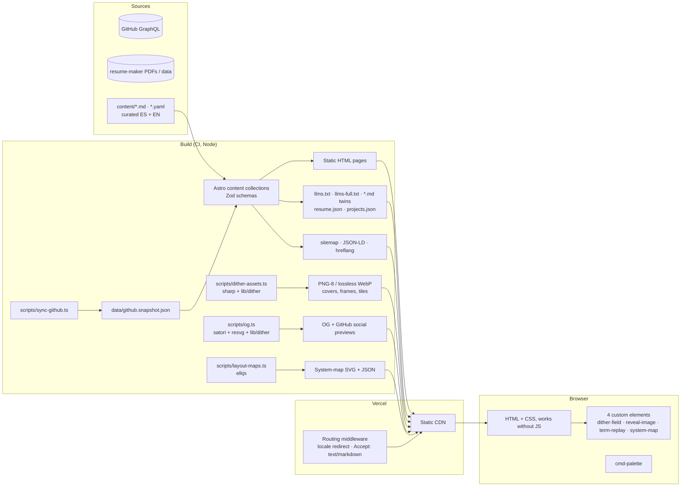

# TRD — diegnghtmr.me (Dither Layer portfolio)

| | |
|---|---|
| Status | Draft v0.3 — 2026-11-21 — Gentleman Kanagawa tokens; dither stack = Paper Shaders (hero) + sharp/image-q (build) + CC0 blue noise |
| Implements | [PRD.md](PRD.md) |
| Design rules | [reference/DESIGN-dither-layer.md](reference/DESIGN-dither-layer.md) (rules kept, brand primitives replaced) |
| Evidence | [research/01 dither](research/01-dither-on-the-web.md) · [02 SEO/AI](research/02-seo-and-ai-first.md) · [03 engagement](research/03-portfolio-engagement-and-repos.md) |

Versions marked *(verify at M0)* must be pinned to the latest stable release when the repository is created; this document fixes the architecture, not the patch numbers.

---

## 1. Architecture at a glance



**Shape of the system:** the site stays fully static. All data is resolved at build time; Routing Middleware negotiates Markdown and routes `/mcp` to a separate read-only Vercel Function. The browser receives HTML that is complete without JavaScript and is progressively enhanced by a handful of small custom elements.

## 2. Key decisions (ADR summary)

| ADR | Decision | Alternatives | Why |
|---|---|---|---|
| 001 | **Astro** (SSG, latest stable *(verify at M0)*) | Next.js 16 (current `portfolio-core`), SvelteKit | Content site with ~4 interactive islands. Astro ships zero JS by default, has typed content collections, trivial `.md`/`.txt`/`.json` endpoints, i18n routing and native View Transitions support. Next would ship the React runtime to every page for no user benefit |
| 002 | **No UI framework runtime by default**; interactive pieces are vanilla **custom elements** in TypeScript | React islands everywhere | Keeps home JS under budget (§9). React stays allowed as a per-island escape hatch if one component grows complex enough to need it — the decision is recorded per island |
| 003 | **Build-time pipeline: sharp + `image-q`** (fixed brand palette, Atkinson/Stucki) plus a ~2 KB own module for ordered and blue-noise thresholds | Own full library, didder (GPL-3.0), sharp palette mode alone, `@thi.ng/pixel-dither` | `image-q` (MIT) maps to the **exact brand inks** with many diffusion kernels; sharp alone cannot guarantee exact inks. The own module only covers Bayer/blue-noise thresholding (trivial, shared with the reveal) — see [research/05](research/05-dither-libraries-and-assets.md) |
| 004 | **`@paper-design/shaders` 0.0.82 (vanilla `ShaderMount` + `Dithering`)**, pinned, for the hero | Custom WebGL2 shader, OGL, regl, three.js + postprocessing | Apache-2.0, active (Nov 2026), shapes sphere/wave/swirl/warp, Bayer 2x2–8x8 and random, cell size, two brand colours, built-in offscreen pause. Import only `dithering` + `shader-mount` (full bundle is 64.9 KB gzip; measure the tree-shaken chunk in M3). 0.0.x can break: pin exact version. A custom shader is written only if a 3–4 ink Statement field is required |
| 005 | **Build-time GitHub snapshot committed to the repo**, refreshed weekly by a bot PR | Runtime API calls, ISR | Deterministic builds, reviewable data diffs, no tokens or rate limits at runtime, works offline |
| 006 | **System-map layout computed at build** (elkjs layered layout → SVG) | Runtime graph libraries (React Flow, Cytoscape) | Zero runtime layout cost, crawlable SVG + list fallback, ~0 KB library in the browser |
| 007 | **Tailwind CSS 4** with CSS-first `@theme` tokens generated from `tokens.json` | Vanilla CSS modules | Matches Diego's stack; tokens stay single-sourced and lintable |
| 008 | **Vercel** hosting with Routing Middleware | Cloudflare Pages | Existing account, previews, Speed Insights; middleware handles locale + markdown negotiation (D5 in PRD) |
| 009 | **Native scroll; no Lenis / GSAP ScrollTrigger** | Smooth-scroll libraries | INP, accessibility and battery; motion comes from CSS, View Transitions and the WAAPI |

## 3. Technology stack

| Layer | Choice | Notes |
|---|---|---|
| Language | TypeScript strict (`exactOptionalPropertyTypes`, `noUncheckedIndexedAccess`) | One tsconfig for site + scripts |
| Framework | Astro *(verify at M0)* | `output: 'static'`, `i18n` with `prefixDefaultLocale: true` |
| Styling | Tailwind CSS 4 (`@tailwindcss/vite`) | Tokens in `src/styles/tokens.css`, generated |
| Interactivity | Custom elements + Web Animations API | `motion` (vanilla `animate`) only if springs are needed in the drawer *(measure first)* |
| Icons | Phosphor (`@phosphor-icons/core` SVGs, inlined at build) | One family, one stroke weight |
| Fonts | Self-hosted via Fontsource, subset Latin + Latin Ext, `font-display: swap`, size-adjusted fallbacks | Grotesk + Iosevka mono (PRD §4.1) |
| Code highlighting | Shiki at build (Astro built-in), theme generated from tokens | No client highlighter |
| Images | `astro:assets` + sharp → AVIF/WebP originals; sharp + `image-q` → PNG-8 / lossless WebP in brand inks | Integer-scale display, `image-rendering: pixelated` on dither assets |
| Dither runtime | `@paper-design/shaders` 0.0.82 (Apache-2.0), pinned | Hero only, lazy on idle |
| Dither assets | Christoph Peters blue noise 64×64 PNG (CC0), Bayer matrices generated in code | Shipped once, cached forever |
| Diagrams | elkjs at build → SVG | Case-study architecture diagrams use the same pipeline |
| OG images | satori + @resvg/resvg-js at build, then dither pass on the art zone | 1200×630 per page and locale; 1280×640 GitHub social previews |
| Structured data | `schema-dts` typed JSON-LD builders | One `@graph` per page |
| Content validation | Zod schemas in content collections | Build fails on invalid content |
| Tests | Vitest (unit), Playwright + `@axe-core/playwright` (e2e/a11y/visual), Lighthouse CI, `lychee` link check | §10 |
| Package manager | pnpm | Lockfile committed |
| CI/CD | GitHub Actions + Vercel Git integration | §11 |
| Analytics | Vercel Web Analytics + Speed Insights (cookieless) | D4 in PRD |

## 4. Repository layout

```
portfolio-me/
├─ docs/                     PRD, TRD, reference/, research/, adr/, templates/
├─ design/                   design explorations (gentle-design)
├─ content/
│  ├─ profile/{en,es}.yaml   bio, roles, experience, education, certifications
│  ├─ projects/{slug}/
│  │  ├─ project.yaml        language-neutral facts (repos, links, dates, shape data)
│  │  ├─ en.md · es.md       narrative (problem, decisions, reflection…)
│  │  ├─ media/              originals (png/webm), casts (*.cast.json), exchanges (*.http.json)
│  ├─ open-source/*.yaml
│  └─ evals/llm-questions.yaml
├─ data/github.snapshot.json generated, committed
├─ scripts/                  sync-github, dither-assets, og, layout-maps, tokens, contrast, indexnow, eval-llms
├─ src/
│  ├─ content.config.ts      collections + Zod schemas
│  ├─ lib/dither/            thresholds (bayer, blue noise), ink ramps, reveal mask
│  ├─ lib/seo/               jsonld builders, meta, hreflang
│  ├─ lib/agent/             markdown renderers for twins, llms.txt builders
│  ├─ elements/              dither-field, reveal-image, term-replay, system-map, cmd-palette
│  ├─ components/            Astro components (Hero, ProjectCard, Window, Instrument, SystemMap, Timeline…)
│  ├─ layouts/               Base, CaseStudy
│  ├─ pages/[lang]/…         routes; endpoints: llms.txt.ts, [...slug].md.ts, resume.json.ts, projects.json.ts
│  ├─ shaders/dither.frag    WebGL2
│  └─ styles/                tokens.css (generated), global.css
├─ middleware.ts             Vercel routing middleware
├─ tests/                    unit/, e2e/, a11y/, visual/
└─ .github/workflows/        ci.yml, refresh-data.yml, deploy-hooks.yml
```

## 5. Content model

### 5.1 Schemas (Zod, abbreviated)

```ts
const Surface = z.enum(['web','mobile','desktop','api','service','cli','harness','protocol','infra','automation','document','library']);
const Status  = z.enum(['live','shipped','in-progress','archived','coursework']);

const Repo = z.object({
  name: z.string(),                       // "studydeck-backend"
  owner: z.string().default('diegnghtmr'),
  surface: Surface,
  role: z.object({ en: z.string(), es: z.string() }),   // what this repo does in the system
  stack: z.array(z.string()),             // display stack, curated
  liveUrl: z.string().url().optional(),
  layer: z.enum(['client','edge','service','data','external']), // system-map lane
  links: z.array(z.object({ to: z.string(), protocol: z.string(), label: z.string().optional() })).default([]),
  media: z.object({ cover: z.string().optional(), loop: z.string().optional(),
                    cast: z.string().optional(), exchanges: z.array(z.string()).default([]) }).default({}),
});

const Project = z.object({
  slug: z.string(),
  status: Status,
  period: z.object({ start: z.string(), end: z.string().optional() }),
  domain: z.array(z.enum(['education','ai-tooling','fintech','health','infra','tools','algorithms'])),
  featured: z.number().int().min(1).max(6).optional(),
  repos: z.array(Repo).min(1),
  external: z.array(z.object({ name: z.string(), protocol: z.string() })).default([]), // PostgreSQL, Keycloak, LLM provider…
  evidence: z.array(z.object({ label: z.string(), value: z.string(), source: z.string().url() })).default([]),
  adrs: z.array(z.object({ title: z.string(), url: z.string().url().optional() })).default([]),
});
```

`shape` is **derived**, never authored: `repos.length > 1 → 'system'`, else `hasUI(repo.surface) ? 'interface' : 'headless'`, where `hasUI = web | mobile | desktop`. Adding a repo to a project changes its presentation automatically.

Narrative per locale (`en.md`, `es.md`) uses required frontmatter `title`, `outcome`, `role`, `summary` and fixed H2 sections (`Problem`, `Constraints`, `Decisions`, `Architecture`, `Validation`, `Reflection`). A remark plugin fails the build if a section is missing in one locale but present in the other.

### 5.2 GitHub snapshot

`scripts/sync-github.ts` (GraphQL, token only in CI) fetches for every repo referenced in `content/`: description, homepage, topics, primary language + language bytes, default branch, last commit date, open-source PRs authored by `diegnghtmr` in external repos (merged state, title, URL, diff stats). Output is sorted and stable so diffs stay readable. Curated content always wins over snapshot fields.

## 6. Dither subsystem

### 6.1 Libraries and assets

| Need | Choice | License |
|---|---|---|
| Hero field (animated) | `@paper-design/shaders@0.0.82`, `ShaderMount` + `ditheringFragmentShader`, shape `sphere` or `wave`, Bayer 8x8, `u_pxSize` 4, colours `#06080F`/`#7FB4CA` (light: `#F3F6F9`/`#24596C`) | Apache-2.0 |
| Exact-palette image dithering (build) | `image-q` 4.0.0: fixed palette from tokens, Atkinson default, Stucki as alternative | MIT |
| Decode / resize / encode (build) | `sharp` 0.35.x | Apache-2.0 |
| Threshold texture | Christoph Peters free blue noise, 64×64 LDR (`LDR_LLL1_0.png`), from momentsingraphics.de (CC0); 128×128 if tiling shows | CC0 |
| Ordered matrices | Bayer 4×4 / 8×8 generated in code | — |
| Source art | Diego's own portrait (owned), curated project screenshots with real data, procedural shapes from Paper; Poly Haven (CC0) renders/HDRIs for any extra art; Unsplash only with its license | per source |

Library notices (Apache-2.0 NOTICE, MIT) are listed on the colophon page.

### 6.2 Build pipeline (`scripts/dither-assets.ts`)

For every project cover, figure and the portrait:

1. **Art direction first** (`content/projects/{slug}/media/*.png` must be curated): capture screenshots with real data (on 2026-11-21 three live demos showed loading skeletons or "No se pudo cargar" because their backends were down, so they are not usable as-is).
2. sharp: resize to each display width (integer multiple of the cell), grayscale or keep luminance, levels/gamma so contours survive, light unsharp mask **before** dithering.
3. `image-q`: quantize to the brand ink ramp (2 inks for small covers, 4 for large figures: dark `#06080F #27345C #7FB4CA #F3F6F9`; light `#06080F #24596C #91C7DD #F3F6F9`) with Atkinson; compare Stucki per asset when Atkinson blows out highlights.
4. Encode PNG-8 and lossless WebP from the quantized pixels (materialized buffer, not chained encoders); keep the smaller.
5. Keep the original as AVIF/WebP for the resolve step.
6. Emit a manifest (`dims`, `inks`, `family`, `cell`, `bytes`) used by components and printed as the effect annotation.
7. Assert A-1/A-2: decoded colour count ≤ ink count, lossless codec, integer cell. Build fails otherwise.

OG images reuse steps 2–4 on their art zone; title and URL are rendered crisp afterwards (never dithered).

### 6.3 Runtime elements

- **`<dither-field>`** (hero, Statement): mounts Paper's `ShaderMount` with `ditheringFragmentShader` after first paint (`requestIdleCallback`). Speed 0.5; `setSpeed(0)` under `prefers-reduced-motion`, on the pause button, and when hidden (Paper also pauses off-screen via its own IntersectionObserver). Cap `maxPixelCount`. The element has a solid `background-color` and a pre-rendered poster PNG (same shape, generated at build) shown before mount, on import failure, on `webglcontextlost`, and under `prefers-contrast: more`, `forced-colors` or `Save-Data`.
- **`<reveal-image>`** (Documentary covers): dithered frame over the original; on view/hover/focus the pixels switch from dither to original where `blueNoise(x, y) < progress`, with progress 0 → 1 over ~700 ms. The threshold mask is **stationary** (no temporal jitter, no shimmer). Implemented on a 2D canvas at cell resolution (≤ 640×400 cells, a few frames). Reduced motion: original immediately. Real "View original" `<button>`.
- **`<term-replay>`** (Headless). Server-rendered `<pre>` holds the full transcript (agents, no-JS, screen readers get everything). JS hides and progressively reveals lines from the cast timings with play/pause and *Show all*; `aria-live` is off during playback to avoid chatter.
- **`<system-map>`** (System). Server-rendered SVG from elkjs + a parallel `<ol>` list view. JS adds roving-tabindex arrow navigation between nodes, edge highlight on hover/focus, a `<dialog>`-based side panel, and a one-time edge-flow animation (stroke-dashoffset) when first in view. Below 640 px the CSS shows the layered list instead of the SVG.
- **Blur surfaces** — nav, `<cmd-palette>` and the map drawer use `backdrop-filter: blur(20px)` over a 95 % surface (the theme's translucent window). `@supports not (backdrop-filter: blur(1px))` and `prefers-reduced-transparency: reduce` fall back to the opaque surface; blur never sits over a dither field behind text.
- **`<cmd-palette>`** — `<dialog>` + fuzzy search over a build-time index (projects, sections, languages, actions such as *copy email*). Opens with ⌘K/Ctrl K and a visible button; no open/close animation (frequency rule).

### 6.4 Tokens and contrast enforcement

`design/tokens.json` holds brand primitives and dither roles for the Gentleman Kanagawa dark theme (source values) and the light theme derived from it (PRD §4.1, [research/04](research/04-gentleman-kanagawa-palette.md)). Dark is the default when the visitor has no preference; `prefers-color-scheme` and a manual toggle switch themes. `scripts/tokens.ts` also implements the derivation (OKLCH lightness search per role target), so a change to a dark token re-derives its light counterpart and CI re-measures it. `scripts/tokens.ts` emits `tokens.css` (Tailwind `@theme`) and a `DESIGN.md` for this brand. `scripts/contrast.ts` checks every declared text/background pair **against every ink that can appear behind it** (worst-ink rule, floored to 2 decimals) and fails CI below 4.5:1 (3:1 for large text and UI boundaries). `npx @google/design.md lint` runs on the generated DESIGN.md (A-3).

## 7. Routing, i18n and edge

- Routes: `/{en|es}/…` generated statically from `getStaticPaths`; each page declares its counterpart for hreflang and the language switch.
- `middleware.ts` (Vercel Routing Middleware):
  - `/` → 307 to `/es/` or `/en/` from `Accept-Language`; crawlers and unknowns get `/en/` (x-default). A static `/index.html` with links exists as a no-middleware fallback.
  - Any HTML route with `Accept: text/markdown` (and not `text/html` preferred) → rewrite to its `.md` twin, set `Content-Type: text/markdown; charset=utf-8` and `Vary: Accept`.
- Cross-document View Transitions via `@view-transition { navigation: auto; }` plus `view-transition-name` on the project cover/title pair; Astro's `ClientRouter` is **not** used (keeps pages independent and JS-free).

## 8. SEO and agent endpoints

| Artifact | Source | Notes |
|---|---|---|
| `<head>` meta | `lib/seo/meta.ts` | title ≤ 60 chars, description ≤ 155, canonical, hreflang (en, es, x-default), OG/Twitter |
| JSON-LD | `lib/seo/jsonld.ts` | `@graph`: `WebSite#site`, `Person#diego` (`sameAs` GitHub, LinkedIn; `knowsLanguage`; `alumniOf`), `ProfilePage` (home/about), `ItemList` (work index), `CreativeWork` per project with `hasPart` → `SoftwareSourceCode` per repo, `BreadcrumbList`. Snapshot-tested |
| `sitemap.xml` | `@astrojs/sitemap` with i18n alternates | `lastmod` from content/snapshot |
| `robots.txt` | endpoint | Search/answer bots allowed; training bots (`GPTBot`, `ClaudeBot`, `Google-Extended`, `CCBot`, `Applebot-Extended`) disallowed (PRD D3); sitemap + llms.txt referenced |
| `/llms.txt` | `lib/agent/llms.ts` | H1, summary blockquote, sections *Profile*, *Projects*, *Open source*, *Machine-readable* with links to `.md` twins and JSON |
| `/llms-full.txt` | same | Whole site in one Markdown file, EN (ES variant at `/es/llms-full.txt`) |
| `*.md` twins | `pages/[lang]/[...slug].md.ts` | Rendered from the same collection entries; facts table + narrative; absolute links |
| `/resume.json` | profile collection | JSON Resume schema, per locale |
| `/projects.json` | projects collection | Canonical public project feed used to build the MCP snapshot |
| IndexNow | `scripts/indexnow.ts` on production deploy | Changed URLs only |

Phase 2 MCP server: `api/mcp.mjs` is a stateless, unauthenticated Node.js Vercel Function at `/mcp`, separate from Astro's static output. The official `@modelcontextprotocol/sdk` v1 handles the `2025-11-25` Streamable HTTP lifecycle; POST returns JSON and GET does not open an SSE stream. `scripts/build-mcp-data.mjs` packages the rendered résumé feeds, project feed, public atlas slugs, and Markdown twins into a private build artifact for the function. The README and `/llms.txt` document the explicit URL. This is not a search-ranking or automatic discovery mechanism.

## 9. Performance budget

| Budget | Limit | Enforced by |
|---|---|---|
| JS on home (initial, gz) | ≤ 20 KB (custom elements + palette), shader chunk ≤ 8 KB loaded on idle | `size-limit` in CI |
| JS on case study (gz) | ≤ 25 KB | `size-limit` |
| CSS (gz, per page) | ≤ 25 KB | `size-limit` |
| Fonts | ≤ 2 preloaded WOFF2, ≤ 70 KB total | Build check |
| LCP element | The hero `<h1>` (text) — never an image or canvas | Lighthouse assertion |
| Images | Dither frames ≤ 15 KB each at 640 w; originals AVIF, `sizes`/`srcset`, lazy below the fold; explicit dimensions (CLS) | Pipeline assertions |
| Third-party scripts | Only Vercel analytics, deferred | CSP |
| Lighthouse (mobile, simulated) | ≥ 95 ×4 on `/en/`, `/en/work/`, one case study | LHCI assertions |
| Field CWV (p75 mobile) | LCP ≤ 2.0 s, INP ≤ 150 ms, CLS ≤ 0.05 | Speed Insights review at M6 + monthly |

## 10. Quality and test strategy

| Level | What | Tool |
|---|---|---|
| Unit | Dither pipeline: output only palette indices (exact brand inks), determinism, Bayer matrix properties, blue-noise mask monotonic reveal; shape derivation; JSON-LD builders; llms.txt builder; hreflang pairs complete | Vitest |
| Content | Schemas, locale parity of sections, every link in `evidence` resolves, every repo exists in the snapshot | Build + lychee |
| Design system | Worst-ink contrast for all pairs (F-1 at token level), DESIGN.md lint (A-3), asset palette/codec checks (A-1/A-2) | scripts in CI |
| E2E | Viewports 320/390/768/1280: no horizontal scroll (F-6), nav, filters in URL, language switch keeps page, command palette, map keyboard navigation, copy-email | Playwright |
| Accessibility | axe on every route ×2 locales; focus ring visible on every control (F-2); reduced-motion run asserts no animation (F-3); `forced-colors` and no-JS runs keep content (F-5) | Playwright + axe |
| Visual | Screenshot baselines per route/viewport/theme | Playwright |
| Performance | §9 budgets | LHCI, size-limit |
| Agent | 10 fixed questions answered from `/llms.txt` only; diffed against expected facts | `scripts/eval-llms.ts` (manual/nightly, needs API key in CI secret) |

## 11. CI/CD

- `ci.yml` on PR: install → lint (ESLint, Prettier) → typecheck → unit → content/design checks → build → size-limit → Playwright (e2e, a11y, visual) against the build → LHCI. Vercel posts a preview URL.
- `refresh-data.yml` weekly (cron): runs `sync-github`, opens a PR if the snapshot changed (CI validates it like any change).
- On production deploy: IndexNow ping for changed URLs.
- Branch protection: `main` requires green CI. Work lands in reviewable work-unit commits (Conventional Commits).

## 12. Security and privacy

- No cookies, no forms, no user data stored. Email shown as text with a copy button.
- Strict CSP (`default-src 'self'`; script hashes only; `img-src 'self' data:`; analytics origin allow-listed), `Referrer-Policy: strict-origin-when-cross-origin`, `Permissions-Policy` minimal, HSTS on the apex.
- GitHub token exists only as a CI secret for the snapshot job; never shipped to the client.
- Phone number from the CV is **not** published on the site.

## 13. Risks

| Risk | Impact | Mitigation |
|---|---|---|
| Domain `diegnghtmr.me` cannot be recovered (expired/taken) | Broken links in CV/README/LinkedIn | Check registrar first thing in M0; fallback domain decided before M6 |
| WebGL cost on low-end Android | INP, battery | Cell-resolution render, DPR cap, 30 fps cap, pause rules, poster fallback; measure on a real mid-range device |
| Dither art reads as "retro gimmick" | Brand | Rebrand palette, restrained coverage (Statement only in hero), effect annotations, Plain everywhere else |
| Projects without screenshots/casts | Weak showcase | Headless modules + generative covers; content task to record VHS casts and capture screens per featured repo |
| Early-stage repos (Savia) overclaimed | Credibility | Status chips, evidence-only claims, *In progress* labels |
| Bilingual content drift | SEO, trust | Locale parity check fails the build |
| `pixelated` rendering differences in Firefox/Safari (open question in DESIGN) | Crispness | Visual tests on WebKit and Firefox in Playwright; integer cells only |

## 14. Milestone → technical deliverables

| Milestone | Deliverables |
|---|---|
| M0 | Astro repo, pnpm, CI skeleton, tokens pipeline + contrast script, content schemas, domain status checked |
| M1 | `content/` for featured six + profile (ES/EN), GitHub snapshot |
| M2 | Layouts, pages, i18n, middleware, SEO + agent endpoints, JSON-LD, sitemap/robots |
| M3 | `lib/dither` + tests, sharp + image-q pipeline, blue-noise asset, `<reveal-image>`, `<dither-field>` on Paper Shaders with poster, Whisper tiles, OG generation |
| M4 | Window, `<term-replay>` + exchanges, elkjs maps + `<system-map>` |
| M5 | View Transitions, `<cmd-palette>`, motion pass, full audit (F/A checks, axe, LHCI) |
| M6 | Production domain, Search Console/Bing/IndexNow, GitHub README/pins/social previews, CV and LinkedIn URLs |
| M7 | MCP server, remaining case studies |
